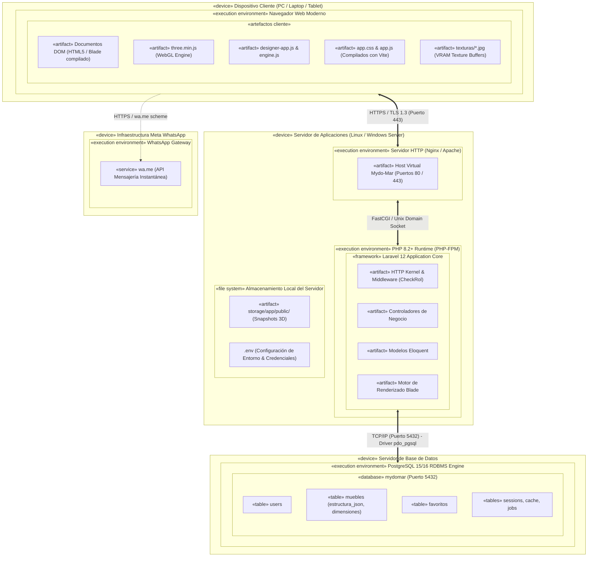
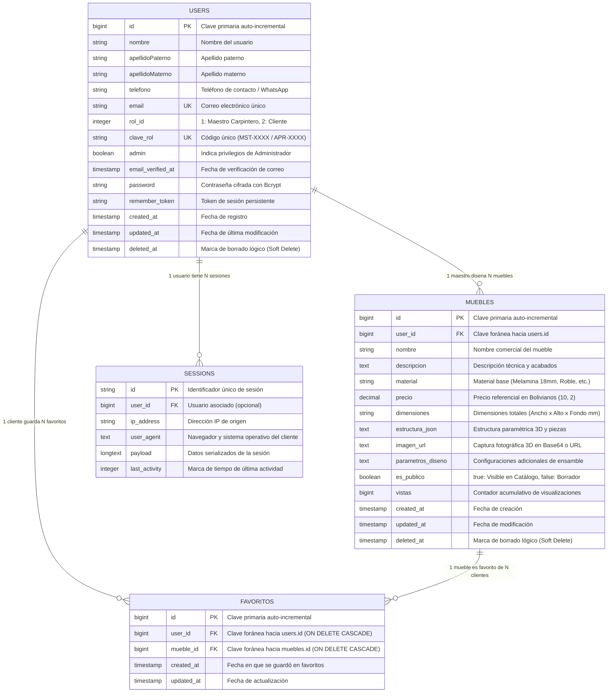

# Memoria Técnica y Documentación de Diagramas UML y Base de Datos: Sistema Mydo-Mar

> **Sistema:** Mydo-Mar (Plataforma Web de Diseño 3D Paramétrico, Optimización de Corte y Catálogo de Muebles de Melamina)  
> **Materia / Área:** Análisis y Diseño de Sistemas II  
> **Tecnologías Base:** Laravel 12 (PHP 8.2+), PostgreSQL 15+, Three.js (WebGL), Bootstrap 5 / Tailwind CSS, Vite  
> **Propósito:** Documento de especificación arquitectónica integral con sintaxis estándar Mermaid y descripciones formales para redacción técnica, defensa de grado o procesamiento por modelos de Inteligencia Artificial.

---

## TABLA DE CONTENIDOS
1. [Diagrama de Paquetes (UML)](#1-diagrama-de-paquetes-uml)
2. [Diagrama de Despliegue (UML)](#2-diagrama-de-despliegue-uml)
3. [Diagrama Entidad-Relación (DER)](#3-diagrama-entidad-relación-der)
4. [Diagrama de Clases (UML)](#4-diagrama-de-clases-uml)

---

# 1. DIAGRAMA DE PAQUETES (UML)

### 1.1. Propósito y Estructura Arquitectural
El **Diagrama de Paquetes** organiza los elementos de análisis, diseño y construcción del sistema en subsistemas jerárquicos basados en una **Arquitectura en Capas (Layered Architecture)**. 

Se garantiza:
- **Alta cohesión:** Cada paquete agrupa elementos con responsabilidades afines (Vistas, Lógica 3D, Seguridad, Controladores, Modelos, Persistencia).
- **Bajo acoplamiento:** Dependencias estrictamente descendentes unidireccionales (`«use»` e `«import»`), evitando ciclos o dependencias circulares.

### 1.2. Diagrama Gráfico en Mermaid

```mermaid
graph TD
    %% ========================================================
    %% CAPA DE PRESENTACIÓN / CLIENTE
    %% ========================================================
    subgraph Capa_Presentacion[" Capa de Presentación (Frontend / Cliente) "]
        direction TB
        subgraph Pkg_VistasBlade["«package» Vistas_Blade"]
            V_Auth["Auth (Login, Registro)"]
            V_Admin["Admin (Dashboard, Gestión Usuarios/Muebles)"]
            V_Maestro["Maestro (Dashboard Taller, Editor 3D)"]
            V_Catalogo["Catálogo (Listado, Ficha Técnica, Guía Armado)"]
        end

        subgraph Pkg_Motor3D["«package» Motor_Diseño_3D"]
            M_Three["designer-app.js (Three.js WebGL & Escena)"]
            M_Engine["engine.js (Cálculo Paramétrico de Cotas)"]
            M_Wizard["wizard.js (Biblioteca de Plantillas Base)"]
            M_Corte["Optimizador_Corte (Algoritmo FFDH Bin-Packing)"]
        end

        subgraph Pkg_Assets["«package» Recursos_UI_Assets"]
            A_Texturas["Texturas Melamina (public/textures)"]
            A_Estilos["Estilos & UI (Bootstrap 5, Tailwind CSS)"]
        end
    end

    %% ========================================================
    %% CAPA DE APLICACIÓN Y SEGURIDAD
    %% ========================================================
    subgraph Capa_Aplicacion[" Capa de Aplicación y Seguridad (Backend) "]
        direction TB
        subgraph Pkg_Seguridad["«package» Seguridad_Middleware"]
            Mid_Auth["Authenticate (auth)"]
            Mid_Rol["CheckRol (rol_id: 1=Maestro, 2=Cliente)"]
            Mid_Admin["EsAdmin (admin = true)"]
        end

        subgraph Pkg_Controladores["«package» Controladores_MVC"]
            C_Mueble["MuebleController"]
            C_Catalogo["CatalogoController"]
            C_Maestro["MaestroController"]
            C_Favorito["FavoritoController"]
            C_Perfil["PerfilController"]
            C_Auth["AuthController"]
        end
    end

    %% ========================================================
    %% CAPA DE DOMINIO Y NEGOCIO
    %% ========================================================
    subgraph Capa_Dominio[" Capa de Dominio (Modelos de Negocio) "]
        subgraph Pkg_Modelos["«package» Modelos_Eloquent"]
            Mod_User["User (Maestro, Cliente, Administrador)"]
            Mod_Mueble["Mueble (JSON 3D, Despiece, Precios)"]
            Mod_Favorito["Favorito (Relación N:M)"]
        end
    end

    %% ========================================================
    %% CAPA DE SERVICIOS E INTEGRACIÓN
    %% ========================================================
    subgraph Capa_Servicios[" Capa de Servicios e Integración "]
        subgraph Pkg_Servicios["«package» Servicios_Externos"]
            S_WhatsApp["Integrador WhatsApp (wa.me +591)"]
            S_PDF["Generador Planos Técnicos (PDF Taller)"]
        end
    end

    %% ========================================================
    %% CAPA DE PERSISTENCIA E INFRAESTRUCTURA
    %% ========================================================
    subgraph Capa_Infraestructura[" Capa de Infraestructura y Datos "]
        subgraph Pkg_Persistencia["«package» Persistencia_Datos"]
            ORM_Eloquent["Laravel Eloquent ORM"]
            DB_Driver["Driver PostgreSQL (pdo_pgsql)"]
            FS_Local["Filesystem Local (Renders Base64, Storage)"]
        end

        subgraph Pkg_BD["«package» Base_Datos_Relacional"]
            T_Users["Tabla: users"]
            T_Muebles["Tabla: muebles"]
            T_Favoritos["Tabla: favoritos"]
            T_Sesiones["Tablas: sessions, cache, jobs"]
        end
    end

    %% ========================================================
    %% DEPENDENCIAS
    %% ========================================================
    Pkg_VistasBlade ..> Pkg_Motor3D : «use»
    Pkg_Motor3D ..> Pkg_Assets : «use»
    Pkg_VistasBlade ..> Pkg_Controladores : «http request»
    
    Pkg_Controladores ..> Pkg_Seguridad : «import»
    Pkg_Controladores ..> Pkg_Modelos : «use»
    Pkg_Controladores ..> Pkg_Servicios : «use»
    
    Pkg_Modelos ..> Pkg_Persistencia : «extends»
    Pkg_Persistencia ..> Pkg_BD : «access»
```

### 1.3. Matriz de Componentes por Paquete

| Paquete | Componentes Incluidos | Responsabilidad Técnica | Dependencias |
|:---|:---|:---|:---|
| **`Vistas_Blade`** | Plantillas Blade (`create`, `show`, `dashboard`, `auth/*`) | Renderizado de interfaz HTML5 responsiva, componentes visuales y modales de confirmación. | `Motor_Diseño_3D`, `Controladores_MVC` |
| **`Motor_Diseño_3D`** | `designer-app.js`, `engine.js`, `wizard.js` | Generación de geometrías Three.js para tableros de melamina (18mm), agrupamiento `THREE.Group`, cálculo métrico UV y algoritmo Bin-Packing FFDH para corte de láminas (2440x1220mm). | `Recursos_UI_Assets` |
| **`Recursos_UI_Assets`** | Mapas de texturas JPEG (`roble_natural`, `melamina_blanca`, `haya`), Bootstrap 5, Tailwind CSS | Texturas escaladas con `RepeatWrapping` métrico y estilos visuales. | *(Ninguna)* |
| **`Seguridad_Middleware`** | `Authenticate`, `CheckRol`, `es_admin` | Filtros de autorización basados en roles de usuario (`rol_id`: 1 Maestro, 2 Cliente, `admin=true`). | *(Ninguna)* |
| **`Controladores_MVC`** | `MuebleController`, `CatalogoController`, `MaestroController`, `FavoritoController`, `PerfilController` | Gestión de peticiones HTTP, validación de formularios, serialización/deserialización de estructuras JSON 3D y retorno de respuestas. | `Seguridad_Middleware`, `Modelos_Eloquent`, `Servicios_Externos` |
| **`Modelos_Eloquent`** | `User.php`, `Mueble.php` | Reglas de negocio del dominio, relaciones relacionales (1:N, N:M), mutadores y casting de atributos. | `Persistencia_Datos` |
| **`Servicios_Externos`** | Módulo de enlace a WhatsApp con formato boliviano (`591`), exportador PDF | Interoperabilidad con servicios de mensajería y generación de documentación imprimible de taller. | *(Ninguna)* |
| **`Persistencia_Datos`** | Eloquent ORM, Driver PDO PostgreSQL, Storage API | Capa de abstracción de datos, control de transacciones y almacenamiento físico de imágenes base64. | `Base_Datos_Relacional` |
| **`Base_Datos_Relacional`** | Tablas PostgreSQL (`users`, `muebles`, `favoritos`, `sessions`) | Almacenamiento seguro, consistente e íntegro (ACID). | *(Ninguna)* |

---

# 2. DIAGRAMA DE DESPLIEGUE (UML)

### 2.1. Propósito y Topología Física
El **Diagrama de Despliegue** modela la configuración de los nodos de procesamiento físico y los entornos de ejecución en los que se ejecutan los artefactos software del sistema Mydo-Mar.

### 2.2. Diagrama Gráfico en Mermaid



### 2.3. Especificaciones de Despliegue de los Nodos

1. **Nodo Cliente (`Dispositivo Cliente`):**
   - **Hardware:** Procesador x86/ARM de 64 bits, memoria RAM mínima 4 GB, GPU con aceleración por hardware compatible con WebGL 2.0.
   - **Software:** Navegador Google Chrome, Microsoft Edge, Mozilla Firefox o Safari.
   - **Artefactos:** Three.js, scripts paramétricos (`designer-app.js`, `engine.js`), estilos Bootstrap/Tailwind y texturas en VRAM.

2. **Nodo Servidor Web y de Aplicación (`Servidor de Aplicaciones`):**
   - **Hardware:** 2 a 4 vCPU, 4 a 8 GB RAM, 40 GB SSD.
   - **Software:** Linux (Ubuntu Server 22.04 LTS) o Windows Server, Nginx 1.24+ / Apache 2.4+, PHP 8.2+ con extensiones `pdo`, `pdo_pgsql`, `mbstring`, `curl`, `gd`.
   - **Artefactos:** Framework Laravel 12, controladores compilados, motor Blade, archivo de configuración segura `.env` y directorio de almacenamiento persistente (`storage/`).

3. **Nodo Servidor de Base de Datos (`Servidor PostgreSQL`):**
   - **Hardware:** 2 a 4 vCPU, 4 a 8 GB RAM, almacenamiento SSD con alta tasa de IOPS.
   - **Software:** PostgreSQL RDBMS versión 15 o superior.
   - **Conexión:** Puerto 5432 autenticado por contraseña encriptada, restringido a la red interna / IP del servidor web.
   - **Artefactos:** Base de datos `mydomar`, tablas relacionales con integridad referencial y columnas de tipo `TEXT` / `JSON` para las especificaciones tridimensionales del mueble.

4. **Nodo Servicio Externo (`WhatsApp Gateway`):**
   - **Software:** Pasarela web pública de mensajería `https://wa.me/`.
   - **Función:** Apertura de canal de comunicación cifrado directo entre el comprador (cliente) y el teléfono verificado del maestro carpintero con el código de país boliviano (`+591`).

---

# 3. DIAGRAMA ENTIDAD-RELACIÓN (DER)

### 3.1. Descripción del Modelo Relacional
El modelo de datos implementado en PostgreSQL garantiza la normalización (3FN), integridad referencial con borrado en cascada (`ON DELETE CASCADE`) y borrado lógico (*Soft Deletes*):
- **`users`:** Almacena todos los usuarios del sistema. Se diferencian por el atributo `rol_id` (1 = Maestro Carpintero, 2 = Cliente/Aprendiz) y la bandera booleana `admin` (superusuario).
- **`muebles`:** Representa los diseños técnicos tridimensionales. Cada mueble pertenece obligatoriamente a un usuario con rol Maestro (`user_id`). Guarda las medidas envolventes, precio en bolivianos (Bs.), imagen de render y la estructura completa de despiece en formato JSON (`estructura_json`).
- **`favoritos`:** Tabla asociativa pura para la relación de muchos a muchos (N:M) entre `users` (clientes) y `muebles`, con restricción de unicidad compuesta `UNIQUE(user_id, mueble_id)`.
- **Tablas de Soporte de Laravel:** `sessions`, `password_reset_tokens`, `cache` y `jobs`.

### 3.2. Diagrama DER en Mermaid (Entidad-Relación Físico)



### 3.3. Diccionario de Datos

#### Tabla: `users`
| Campo | Tipo | Nulo | Clave | Descripción |
|:---|:---|:---:|:---:|:---|
| `id` | `BIGINT` | No | PK | Identificador único del usuario. |
| `nombre` | `VARCHAR(255)` | No | | Nombre de pila. |
| `apellidoPaterno` | `VARCHAR(255)` | No | | Primer apellido. |
| `apellidoMaterno` | `VARCHAR(255)` | No | | Segundo apellido. |
| `telefono` | `VARCHAR(255)` | No | | Teléfono para cotizaciones por WhatsApp. |
| `email` | `VARCHAR(255)` | No | UK | Correo para inicio de sesión único. |
| `rol_id` | `INTEGER` | No | | Rol asignado (1 = Maestro, 2 = Cliente/Aprendiz). |
| `clave_rol` | `VARCHAR(255)` | No | UK | Código institucional de rol. |
| `admin` | `BOOLEAN` | No | | Superusuario (acceso a `/admin/perfil`). Por defecto `false`. |
| `password` | `VARCHAR(255)` | No | | Hash seguro generado con Bcrypt (`rounds=12`). |
| `deleted_at` | `TIMESTAMP` | Sí | | Fecha de eliminación lógica (Soft Deletes). |

#### Tabla: `muebles`
| Campo | Tipo | Nulo | Clave | Descripción |
|:---|:---|:---:|:---:|:---|
| `id` | `BIGINT` | No | PK | Identificador único del mueble. |
| `user_id` | `BIGINT` | No | FK | Identificador del maestro creador (`users.id`). |
| `nombre` | `VARCHAR(255)` | No | | Título del mueble (ej. Escritorio Ejecutivo). |
| `descripcion` | `TEXT` | Sí | | Descripción detallada de componentes y usos. |
| `material` | `VARCHAR(255)` | Sí | | Tipo de melamina o acabado principal. |
| `precio` | `DECIMAL(10,2)` | Sí | | Precio presupuestado en Bolivianos (Bs.). |
| `dimensiones` | `VARCHAR(255)` | Sí | | Medidas exteriores en milímetros (Ej: `1200x750x600`). |
| `estructura_json` | `TEXT` | Sí | | JSON con piezas, coordenadas 3D, texturas y rotaciones. |
| `imagen_url` | `TEXT` | Sí | | Cadena DataURI en Base64 con la captura 3D o ruta local. |
| `es_publico` | `BOOLEAN` | No | | Estado de publicación (`true` = catálogo público). |
| `vistas` | `BIGINT` | No | | Métrica de popularidad y clics recibidos. |

#### Tabla: `favoritos`
| Campo | Tipo | Nulo | Clave | Descripción |
|:---|:---|:---:|:---:|:---|
| `id` | `BIGINT` | No | PK | Identificador de registro. |
| `user_id` | `BIGINT` | No | FK | Cliente que marcó el favorito (`users.id`). |
| `mueble_id` | `BIGINT` | No | FK | Mueble guardado (`muebles.id`). |
| Restricción | `UNIQUE(user_id, mueble_id)` | — | — | Impide duplicidad de guardado por un mismo usuario. |

---

# 4. DIAGRAMA DE CLASES (UML)

### 4.1. Descripción del Modelo Orientado a Objetos
El **Diagrama de Clases** describe la estructura estática del software, especificando clases, atributos tipados, visibilidad (`+` público, `-` privado, `#` protegido), métodos y relaciones:
1. **Modelos de Dominio (Capa Modelo):** Clases `User` y `Mueble` que heredan de `Model` / `Authenticatable` de Eloquent.
2. **Capa Controladora (Capa Control):** Controladores encargados de gestionar el ciclo de vida de los datos y orquestar las respuestas HTTP.
3. **Capa de Filtros (Middleware):** `CheckRol` para validación de permisos de acceso.
4. **Módulos del Frontend (JavaScript Orientado a Objetos):** `DesignerApp`, `ParametricEngine`, `TextureManager` y `CuttingOptimizer`.

### 4.2. Diagrama de Clases en Mermaid

```mermaid
classDiagram
    %% ========================================================
    %% HERENCIA Y CLASES DEL FRAMEWORK
    %% ========================================================
    class Authenticatable {
        <<Framework Core>>
    }
    class Model {
        <<Framework Core>>
    }
    class Controller {
        <<Framework Core>>
    }

    %% ========================================================
    %% MODELOS ELOQUENT
    %% ========================================================
    class User {
        -BigInteger id
        +String nombre
        +String apellidoPaterno
        +String apellidoMaterno
        +String telefono
        +String email
        +Integer rol_id
        +String clave_rol
        +Boolean admin
        -String password
        +Timestamp created_at
        +muebles() HasMany
        +favoritos() BelongsToMany
        +esMaestro() Boolean
        +esCliente() Boolean
    }

    class Mueble {
        -BigInteger id
        +BigInteger user_id
        +String nombre
        +String descripcion
        +String material
        +Decimal precio
        +String dimensiones
        +Text estructura_json
        +Text imagen_url
        +Boolean es_publico
        +BigInteger vistas
        +user() BelongsTo
        +esFavoritoDe() BelongsToMany
        +incrementarVistas() Void
    }

    Authenticatable <|-- User
    Model <|-- Mueble

    User "1" --> "0..*" Mueble : disena / esDueno
    User "0..*" <--> "0..*" Mueble : tieneFavoritos (tabla favoritos)

    %% ========================================================
    %% CONTROLADORES MVC
    %% ========================================================
    class MuebleController {
        +create() View
        +store(Request request) JsonResponse
        -validarEstructura3D(Array data) Boolean
    }

    class CatalogoController {
        +index(Request request) View
        +show(int id) View
        +guiaArmado(int id) View
        -generarEnlaceWhatsApp(String telefono, String mueble) String
    }

    class MaestroController {
        +dashboard() View
        +edit(int id) View
        +update(Request request, int id) RedirectResponse
        +destroy(int id) RedirectResponse
    }

    class FavoritoController {
        +index() View
        +toggle(int id) JsonResponse
    }

    class PerfilController {
        +index() View
        +update(Request request) RedirectResponse
        +adminDashboard() View
        +toggleAdmin(int id) JsonResponse
        +destroyUser(int id) RedirectResponse
        +destroyMueble(int id) RedirectResponse
    }

    Controller <|-- MuebleController
    Controller <|-- CatalogoController
    Controller <|-- MaestroController
    Controller <|-- FavoritoController
    Controller <|-- PerfilController

    MuebleController ..> Mueble : manipula
    CatalogoController ..> Mueble : consulta
    MaestroController ..> Mueble : gestiona
    FavoritoController ..> Mueble : asocia
    FavoritoController ..> User : asocia
    PerfilController ..> User : administra
    PerfilController ..> Mueble : modera

    %% ========================================================
    %% MIDDLEWARE DE SEGURIDAD
    %% ========================================================
    class CheckRol {
        +handle(Request request, Closure next, int rol) Response
    }

    MuebleController ..> CheckRol : protegido por rol 1
    MaestroController ..> CheckRol : protegido por rol 1
    FavoritoController ..> CheckRol : protegido por rol 2

    %% ========================================================
    %% MÓDULOS DE NEGOCIO CLIENTE (FRONTEND THREE.JS)
    %% ========================================================
    class DesignerApp {
        -Scene scene
        -PerspectiveCamera camera
        -WebGLRenderer renderer
        -OrbitControls controls
        -Group assemblyGroup
        -Boolean isGroupLocked
        +init() Void
        +addPiece(String type, Float w, Float h, Float d) Mesh
        +toggleAssemblyLock() Void
        +applyTextureToSelected(String textureKey) Void
        +applyTextureToAll(String textureKey) Void
        +exportJSON() Object
        +captureSnapshot() String
    }

    class ParametricEngine {
        +snapToGrid(Vector3 pos, Float gridSize) Vector3
        +calculateBoundingBox(Group group) Object
        +attachHardware(Mesh door, String hardwareType) Void
        +calculateKerf(Float sheetW, Float sheetH, Array pieces) Object
    }

    class TextureManager {
        -Map texturesLoaded
        +loadTexture(String key, String url) Texture
        +computeUVRepeat(Float widthMm, Float heightMm) Vector2
    }

    class CuttingOptimizer {
        -Float sheetWidth = 2440
        -Float sheetHeight = 1220
        -Float kerf = 4.0
        +optimizeFFDH(Array panels) Object
        +generateCuttingLayout(Canvas canvas) Void
        +printWorkshopReportPDF() Void
    }

    DesignerApp *-- ParametricEngine : compone
    DesignerApp *-- TextureManager : utiliza
    DesignerApp ..> CuttingOptimizer : alimenta piezas a
    V_Maestro ..> DesignerApp : inicializa en canvas
```



### 4.3. Relaciones entre Clases y Multiplicidades
1. **`User` a `Mueble` (1 a 0..*):** Un maestro carpintero puede crear ninguno o muchos muebles en el catálogo. Un mueble pertenece indispensablemente a un único usuario creador (`user_id`).
2. **`User` a `Mueble` (Muchos a Muchos vía `favoritos`):** Un cliente puede marcar como favoritos múltiples muebles del catálogo; un mueble puede ser guardado por múltiples clientes.
3. **`DesignerApp` a `ParametricEngine` (Composición):** El motor principal de la escena 3D contiene y gobierna la lógica paramétrica matemática para el cálculo métrico en milímetros de tableros (espesor constante de 18 mm).
4. **`DesignerApp` a `TextureManager` (Uso/Asociación):** Administra la carga asíncrona de texturas fotográficas (`roble_natural`, `nogal_oscuro`, etc.) y el cálculo de escala UV métrica para evitar estiramientos de veta.
5. **Controladores a Modelos (Dependencia `«use»`):** Los controladores ejecutan consultas Eloquent mediante inyección de dependencias y validan la integridad de datos antes de persistirlos en la base de datos PostgreSQL.

---

## RESUMEN DE PROPIEDADES TÉCNICAS CLAVE PARA REDACCIÓN

- **Despiece Paramétrico:** Todas las cotas del sistema de diseño se manipulan en **milímetros (mm)**, considerando tableros de melamina estándar de **18 mm** de grosor y planchas matrices de **2440 × 1220 mm**.
- **Agrupamiento Sólido:** El diseñador Three.js implementa un nodo raíz `THREE.Group` centrado en la base del mueble para rotaciones coordinadas (`Q`, `E`) y traslaciones espaciales (`W`, `A`, `S`, `D` y ratón) sin deformar el ensamble.
- **Seguridad en Rutas:** Acceso granular protegido por roles numéricos en base de datos (`rol_id: 1` para Maestros, `rol_id: 2` para Clientes) y control booleano (`admin: true`) para administración integral del sistema.
- **Canal de Venta:** Integración nativa con WhatsApp Business mediante generación dinámica de URL codificada con prefijo Bolivia (`+591`) que transfiere el nombre del mueble y los datos del comprador al carpintero.
