# DOCUMENTO 2: DISEÑO Y MODELADO DEL SISTEMA (MYDO-MAR)

> **Proyecto:** Sistema de Gestión de Planos Técnicos, Listas de Despiece y Guías de Ensamblaje Tridimensional (Mydo-Mar)  
> **Institución:** Instituto Tecnológico Santa Cruz (ITSC)  
> **Carrera:** Técnico Superior en Sistemas Informáticos  
> **Materia:** Análisis y Diseño de Sistemas II  
> **Estudiante:** Mauricio Miguel Quispe Flores  
> **Docente:** Lic. Gina Faviola Borda Mendez  
> **Año:** 2026  
> **Base de Datos Oficial:** PostgreSQL / SQL Server (10 Tablas Relacionales Normalizadas en 3FN)

---

## ÍNDICE GENERAL
1. [MODELO DE CASOS DE USO (UML)](#1-modelo-de-casos-de-uso-uml)
   - 1.1. Matriz de Mapeo de Requerimientos Funcionales vs. Casos de Uso
   - 1.2. Diagramas y Especificaciones de Casos de Uso (CU-01 al CU-10)
2. [DIAGRAMAS DE SECUENCIA (SC-01 a SC-05)](#2-diagramas-de-secuencia-sc-01-a-sc-05)
   - SC-01: Autenticar Usuario
   - SC-02: Gestionar Publicación de Muebles
   - SC-03: Consultar Detalle de Mueble y Catálogo
   - SC-04: Gestionar Favoritos
   - SC-05: Cambiar Estado de Cuenta de Usuario
3. [DIAGRAMAS DE COLABORACIÓN / COMUNICACIÓN (DC-01 a DC-03)](#3-diagramas-de-colaboración--comunicación-dc-01-a-dc-03)
   - DC-01: Autenticación de Usuario
   - DC-02: Creación y Desactivación de Muebles
   - DC-03: Auditoría y Cambio de Estado de Usuarios
4. [DIAGRAMA ENTIDAD-RELACIÓN OFICIAL (DER - 10 TABLAS EN 3FN)](#4-diagrama-entidad-relación-oficial-der---10-tablas-en-3fn)
   - 4.1. Esquema Relacional de Entidades y Cardinalidades
   - 4.2. Diccionario de Datos Completo (Las 10 Tablas del Sistema)
5. [DIAGRAMA DE CLASES DEL DOMINIO (UML)](#5-diagrama-de-clases-del-dominio-uml)
6. [DIAGRAMAS DE PAQUETES (UML)](#6-diagramas-de-paquetes-uml)
7. [DIAGRAMAS DE DESPLIEGUE (UML)](#7-diagramas-de-despliegue-uml)

---

# 1. MODELO DE CASOS DE USO (UML)

## 1.1. Matriz de Mapeo de Requerimientos Funcionales vs. Casos de Uso

| Código CU | Nombre del Caso de Uso | Requerimientos Funcionales Cubiertos (RF) | Actor Principal | Relación / Dependencia UML |
| :--- | :--- | :--- | :--- | :--- |
| **CU-01** | **Autenticar Usuario** | RF-00: Autenticación con correo y contraseña, control de sesión y redirección según rol. | Usuario (General) | Caso base (`«include»` en CU-02, CU-04, CU-07, CU-08, CU-09, CU-10). |
| **CU-02** | **Gestionar Publicación de Muebles** | RF-01 (Crear proyecto), RF-02 (Editar datos), RF-03 (Eliminar mueble propio), RF-05 (Render/captura 3D), RF-12 (Publicar catálogo). | Maestro Carpintero (Diseñador) | `«include» CU-01`. Base para CU-03. |
| **CU-03** | **Configurar Herrajes y Accesorios** | RF-09 (Definir herrajes: bisagras cazoleta 35mm, jaladores, rieles telescópicos), RF-10 (Tiempo estimado). | Maestro Carpintero (Diseñador) | `«include» CU-02`. |
| **CU-04** | **Buscar y Filtrar Catálogo** | RF-13 (Visualizar catálogo), RF-14 (Buscar por palabra clave), RF-15 (Filtrar por nivel), RF-16 (Filtrar por categoría), RF-17 (Filtrar por tiempo). | Estudiante (Armador) / Cliente | `«include» CU-01`. Base para CU-05. |
| **CU-05** | **Consultar Ficha Técnica y Detalle** | RF-18 (Vista detallada), RF-19 (Visualizar render y modelo 3D), RF-20 (Lista de corte), RF-21 (Lista de herrajes). | Estudiante (Armador) / Cliente | `«include» CU-04`. Base para CU-06. |
| **CU-06** | **Reproducir Animación y Descargar PDF** | RF-08 (Lista de despiece), RF-11 (Cálculo de tableros), RF-22 (Guía interactiva 3D), RF-23 (Descargar planos en PDF). | Estudiante (Armador) | `«include» CU-05`. |
| **CU-07** | **Guardar en Favoritos** | RF-24 (Guardar/quitar proyectos en favoritos con confirmación modal). | Estudiante (Armador) / Cliente | `«include» CU-01`. |
| **CU-08** | **Gestionar Cuentas de Usuario** | RF-25 (Gestión integral de usuarios, asignación de roles y cambio de estado activo/inactivo). | Administrador | `«include» CU-01`. |
| **CU-09** | **Gestionar Categorías Globales** | RF-06 (Clasificación por categoría), RF-26 (CRUD de categorías globales de muebles). | Administrador | `«include» CU-01`. |
| **CU-10** | **Auditar Proyectos Publicados** | RF-27 (Auditar proyectos, aprobar/rechazar calidad y consultar bitácora de actividad). | Administrador | `«include» CU-01`. |

---

## 1.2. Diagramas y Especificaciones de Casos de Uso (CU-01 al CU-10)

```mermaid
graph LR
    %% Actores
    User((Usuario))
    Maestro((Maestro Carpintero))
    Estudiante((Estudiante / Cliente))
    Admin((Administrador))

    Maestro --|> User
    Estudiante --|> User
    Admin --|> User

    %% Casos de Uso
    CU01([CU-01: Autenticar Usuario])
    CU02([CU-02: Gestionar Publicación])
    CU03([CU-03: Configurar Herrajes])
    CU04([CU-04: Buscar y Filtrar])
    CU05([CU-05: Consultar Ficha Técnica])
    CU06([CU-06: Reproducir 3D y PDF])
    CU07([CU-07: Guardar en Favoritos])
    CU08([CU-08: Gestionar Cuentas])
    CU09([CU-09: Gestionar Categorías])
    CU10([CU-10: Auditar Proyectos])

    %% Relaciones de Actores a CU
    User --> CU01
    Maestro --> CU02
    Maestro --> CU03
    Estudiante --> CU04
    Estudiante --> CU05
    Estudiante --> CU06
    Estudiante --> CU07
    Admin --> CU08
    Admin --> CU09
    Admin --> CU10

    %% Inclusiones
    CU02 -.->|«include»| CU01
    CU03 -.->|«include»| CU02
    CU04 -.->|«include»| CU01
    CU05 -.->|«include»| CU04
    CU06 -.->|«include»| CU05
    CU07 -.->|«include»| CU01
    CU08 -.->|«include»| CU01
    CU09 -.->|«include»| CU01
    CU10 -.->|«include»| CU01
```

---

### CU-01: Autenticar Usuario
* **Actor Principal:** Usuario (Base: Maestro, Estudiante, Administrador).
* **Pantallas Involucradas:** 1. Pantalla Login, 2. Comprobación de Credenciales, 3. Pantalla Usuario (según rol).
* **Precondición:** El usuario debe estar registrado en la base de datos de Mydo-Mar.
* **Flujo Principal:**
  1. El usuario accede a la pantalla de Login (`/login`).
  2. Ingresa su correo electrónico y contraseña.
  3. El sistema comprueba el correo electrónico registrado (`«include»`).
  4. El sistema comprueba el hash de la contraseña con algoritmo Bcrypt (`«include»`).
  5. Si las credenciales son válidas, el usuario es identificado según su rol:
     - Si es Administrador (`admin=true`): Redirige a Pantalla Administrador (`/admin/perfil`).
     - Si es Maestro Carpintero (`rol_id=1`): Redirige a Pantalla Maestro Carpintero (`/maestro/dashboard`).
     - Si es Estudiante/Cliente (`rol_id=2`): Redirige a Pantalla Inicio Estudiante (`/catalogo`).
* **Flujo Alternativo (Credenciales no admitidas):**
  - Si el correo o la contraseña no coinciden, se ejecuta la extensión (`«extend» Credenciales No Admitidas`) y el sistema muestra un mensaje de alerta: *"Estas credenciales no coinciden con nuestros registros"*.
* **Postcondición:** Se genera la sesión segura en la tabla `sessions`.

---

### CU-02: Gestionar Publicación de Muebles
* **Actor Principal:** Maestro Carpintero.
* **Pantallas Involucradas:** 1. Pantalla de Publicación, 2. Pantalla del Editor 3D, 3. Pantalla de Creación.
* **Precondición:** El usuario debe estar autenticado (`«include» CU-01`) y contar con `rol_id = 1`.
* **Flujo Principal:**
  1. El maestro accede a su panel de taller (`/maestro/dashboard`).
  2. Selecciona **Crear Mueble** (`/muebles/crear`). El sistema inicializa el lienzo Three.js en blanco.
  3. El maestro parametriza los tableros de melamina (18 mm), selecciona texturas locales y presiona **Guardar y Publicar**.
  4. El sistema captura el render 3D en base64, serializa la `estructura_json` del mueble y guarda la tupla en la tabla `muebles` / `Disenos`.
  5. El mueble queda publicado y visible en el catálogo general.
* **Sub-operaciones y Extensiones:**
  - **Modificar Mueble:** Permite editar medidas exteriores, precio en Bs. o descripción técnica.
  - **Eliminar Mueble:** Permite ejecutar la baja lógica/física del proyecto propio.
* **Postcondición:** El mueble se persiste en la base de datos con estado publicado.

---

### CU-03: Configurar Herrajes y Accesorios
* **Actor Principal:** Maestro Carpintero (Diseñador).
* **Pantallas Involucradas:** 1. Pantalla Lista de Herrajes, 2. Formulario de Herraje.
* **Precondición:** El proyecto de mueble debe estar en proceso de diseño o edición (`«include» CU-02`).
* **Flujo Principal:**
  1. En el diseñador 3D, el maestro accede a la pestaña **Herrajes**.
  2. Selecciona el tipo de herraje:
     - **Bisagras de Cazoleta (35mm):** Aplica a puertas batientes (calculadas a 100mm de extremos).
     - **Jaladores:** Aplica en frente de cajones o puertas (centrados o laterales a 50mm).
     - **Rieles Telescópicos:** Aplica a cajoneras y módulos deslizables.
  3. El sistema asigna cantidad, acabado (Acero Inoxidable / Negro Mate) y especificación técnica.
  4. El herraje se integra en la visualización tridimensional y en la lista de despiece.
* **Flujo Alternativo:**
  - `«extend» Notificar Herraje Duplicado`: Si el maestro intenta agregar bisagras repetidas en la misma coordenada, el sistema alerta la duplicidad.
* **Postcondición:** La configuración de accesorios se indexa dentro del diseño del mueble.

---

### CU-04: Buscar y Filtrar Catálogo
* **Actor Principal:** Estudiante / Cliente.
* **Pantallas Involucradas:** 1. Pantalla del Catálogo, 2. Pantalla de Filtros Avanzados.
* **Precondición:** Ninguna (acceso público en `/catalogo`) o usuario autenticado (`«include» CU-01`).
* **Flujo Principal:**
  1. El usuario ingresa a `/catalogo`.
  2. El sistema muestra la cuadrícula paginada de muebles publicados con foto 3D, autor y precio en Bs.
  3. El usuario puede aplicar criterios de refinamiento:
     - **Buscar por Palabra Clave:** Nombre o descripción del diseño.
     - **Filtrar por Categoría:** Escritorios, Libreros, Gabinetes, Mesas.
     - **Filtrar por Nivel de Dificultad / Tiempo Estimado.**
  4. El sistema procesa la consulta y actualiza los resultados en pantalla.
* **Flujo Alternativo:**
  - `«extend» Notificar Sin Resultados`: Si ningún mueble coincide, muestra el mensaje de catálogo vacío.
  - `«extend» Limpiar Criterios de Búsqueda`: Restablece la consulta general.

---

### CU-05: Consultar Ficha Técnica y Detalle
* **Actor Principal:** Estudiante / Cliente.
* **Pantallas Involucradas:** 1. Vista Detallada del Proyecto, 2. Pestaña Ficha Técnica.
* **Precondición:** Haber seleccionado un mueble desde el catálogo (`«include» CU-04`).
* **Flujo Principal:**
  1. El usuario hace clic sobre un mueble en el catálogo (`/catalogo/{id}`).
  2. El sistema carga la ficha completa:
     - Visor interactivo Three.js con orbitación 3D del mueble terminado.
     - Dimensiones envolventes (Ancho x Alto x Fondo en mm).
     - Lista de tableros de melamina (espesor, longitud, ancho y acabado de veta).
     - Lista de herrajes requeridos.
     - Botón de cotización directa por WhatsApp con el maestro (`wa.me/591...`).
* **Extensiones:**
  - `«extend» Ampliar Vista del Render 3D`: Maximiza el visor a pantalla completa.
  - `«extend» Notificar Error de Carga 3D`: Muestra imagen estática de respaldo si falla WebGL.

---

### CU-06: Reproducir Animación y Descargar PDF
* **Actor Principal:** Estudiante (Armador).
* **Pantallas Involucradas:** 1. Pantalla Visor de Armado, 2. Diálogo de Descarga.
* **Precondición:** Estar dentro de la ficha técnica del mueble (`«include» CU-05`).
* **Flujo Principal:**
  1. El estudiante pulsa en **Guía de Armado Paso a Paso** (`/catalogo/{id}/guia-armado`).
  2. El visor reproduce la animación secuencial de ensamblaje (base, laterales, repisas, puertas y herrajes).
  3. El estudiante puede interactuar mediante **Pausar o Rebobinar Animación** (`«extend»`).
  4. El estudiante presiona **Descargar Hoja de Taller (PDF)**.
  5. El sistema compila y descarga el documento técnico con lista de corte y esquema de armado.
* **Flujo Alternativo:**
  - `«extend» Notificar Error de Descarga PDF`: Si el renderizado de la hoja técnica se interrumpe, alerta al usuario para reintentar.

---

### CU-07: Guardar en Favoritos
* **Actor Principal:** Estudiante / Cliente.
* **Pantallas Involucradas:** 1. Pantalla Mis Favoritos (`/favoritos`), 2. Modal de Confirmación.
* **Precondición:** El usuario debe haber iniciado sesión con rol Cliente (`«include» CU-01`, `rol_id = 2`).
* **Flujo Principal:**
  1. Al navegar el catálogo o la ficha técnica, el cliente presiona el icono de corazón / favorito.
  2. El sistema ejecuta una petición AJAX a `/favoritos/{id}` e inserta la relación en la base de datos.
  3. En la pantalla `/favoritos`, el usuario consulta todos sus proyectos guardados.
* **Flujo de Eliminación de Favorito:**
  1. El usuario pulsa **Quitar Proyecto de Favoritos**.
  2. El sistema despliega el modal: *¿Desea quitar el mueble de sus favoritos?*
  3. Si presiona **Confirmar Eliminación (Botón SÍ)**: Se ejecuta la eliminación en base de datos.
  4. Si presiona **Cancelar Acción (Botón NO)**: Se cierra el modal sin alterar los datos.

---

### CU-08: Gestionar Cuentas de Usuario
* **Actor Principal:** Administrador.
* **Pantallas Involucradas:** 1. Pantalla Gestión de Cuentas (`/admin/perfil`), 2. Formulario de Cuenta.
* **Precondición:** Usuario autenticado con privilegios de Administrador (`admin = true`).
* **Flujo Principal:**
  1. El administrador accede al panel de control de usuarios.
  2. Visualiza la lista completa de maestros, clientes y administradores con su estado actual.
  3. Acciones disponibles:
     - **Registrar / Modificar Cuenta:** Edita nombres, correo, teléfono y clave institucional.
     - **Asignar Rol de Usuario:** Alterna entre Maestro Carpintero y Cliente (`«extend» Modal de Confirmación SÍ / NO`).
     - **Cambiar Estado de Cuenta:** Activa o desactiva usuarios mediante Soft Delete (`«extend» Modal de Confirmación SÍ / NO`).
* **Flujo Alternativo:**
  - `«extend» Notificar Correo Duplicado`: Previene el registro de cuentas con email existente en la tabla `Usuarios`.

---

### CU-09: Gestionar Categorías Globales
* **Actor Principal:** Administrador.
* **Pantallas Involucradas:** 1. Pantalla de Visualización de Categorías, 2. Formulario de Registro/Edición.
* **Precondición:** Autenticado como Administrador (`«include» CU-01`).
* **Flujo Principal:**
  1. El administrador visualiza las categorías de muebles activas (Escritorios, Cocina, Roperos, Estantes).
  2. Puede:
     - **Registrar Categoría:** Introduce nombre descriptivo e icono representativo.
     - **Modificar Categoría:** Actualiza denominación o descripción.
     - **Eliminar Categoría:** Despliega modal de confirmación (*¿Desea eliminar esta categoría?*).
* **Flujo Alternativo:**
  - `«extend» Notificar Categoría Duplicada`: Impide guardar categorías homónimas.

---

### CU-10: Auditar Proyectos Publicados
* **Actor Principal:** Administrador.
* **Pantallas Involucradas:** 1. Pantalla de Visualización de Auditoría, 2. Detalle de Auditoría de Proyecto.
* **Precondición:** Autenticado como Administrador (`«include» CU-01`).
* **Flujo Principal:**
  1. El administrador ingresa al módulo de moderación y auditoría de proyectos.
  2. Selecciona un mueble publicado para inspeccionar sus parámetros físicos (estabilidad de tableros, despiece y fotos).
  3. **Aprobar / Rechazar Proyecto:** Ejecuta la acción modal (*¿Desea cambiar el estado de auditoría?*). Si aprueba, el mueble se certifica; si rechaza, se oculta del catálogo.
  4. **Consultar Bitácora de Actividad:** Revisa el historial de modificaciones realizadas por el maestro.
* **Flujo Alternativo:**
  - `«extend» Notificar Bitácora Vacía`: Informa cuando un proyecto no registra ediciones previas.

---

# 2. DIAGRAMAS DE SECUENCIA (SC-01 a SC-05)

## SC-01: Autenticar Usuario

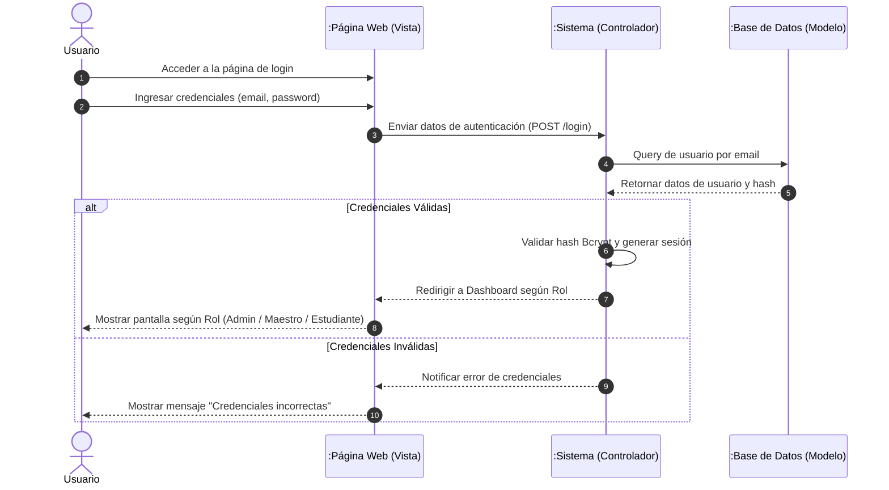

---

## SC-02: Gestionar Publicación de Muebles

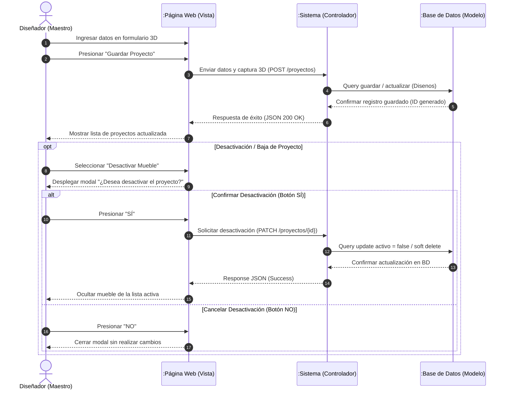

---

## SC-03: Consultar Detalle de Mueble y Catálogo

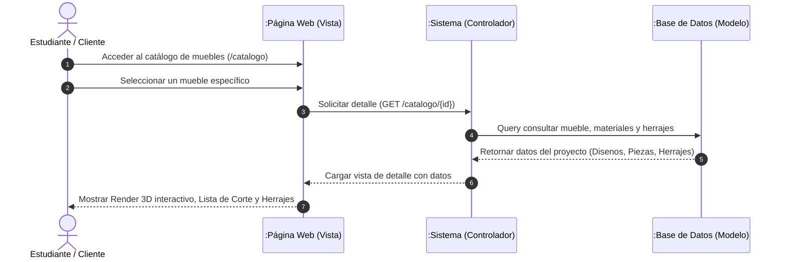

---

## SC-04: Gestionar Favoritos

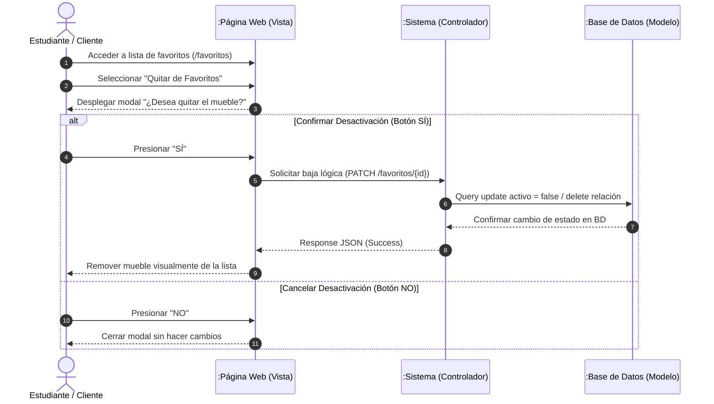

---

## SC-05: Cambiar Estado de Cuenta de Usuario

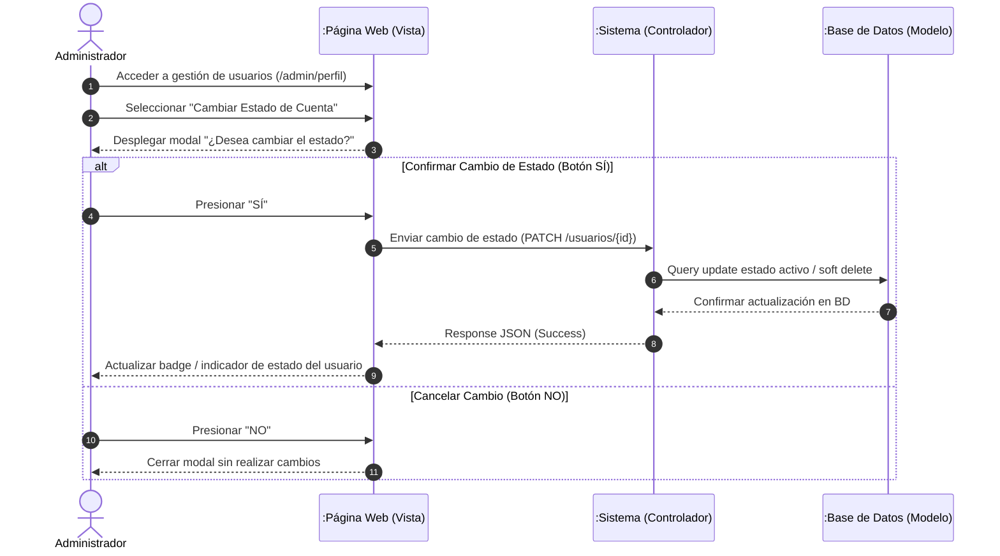

---

# 3. DIAGRAMAS DE COLABORACIÓN / COMUNICACIÓN (DC-01 a DC-03)

## DC-01: Autenticación de Usuario

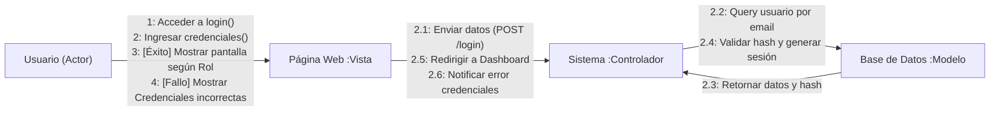

---

## DC-02: Creación y Desactivación de Muebles

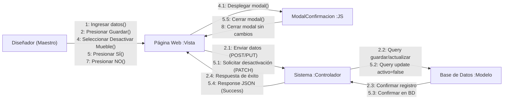

---

## DC-03: Auditoría y Cambio de Estado de Usuarios

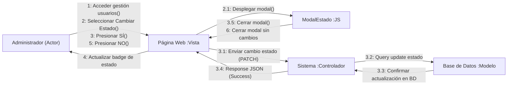

---

# 4. DIAGRAMA ENTIDAD-RELACIÓN OFICIAL (DER - 10 TABLAS EN 3FN)

## 4.1. Esquema Relacional de Entidades y Cardinalidades

Este modelo representa la **estructura relacional oficial y completa de 10 tablas**, normalizada bajo la **Tercera Forma Normal (3FN)**:

```
Orden de creación de tablas:
1. rolUsuario        (sin dependencias)
2. Nivel             (sin dependencias)
3. Categorias        (sin dependencias)
4. Materiales        (sin dependencias)
5. Usuarios          (→ rolUsuario)
6. Disenos           (→ Usuarios, Categorias, Nivel)
7. Piezas            (→ Disenos)
8. Herrajes          (→ Disenos)
9. PasosEnsamblaje   (→ Disenos)
10. ProgresoAlumno   (→ Usuarios, Disenos)
```

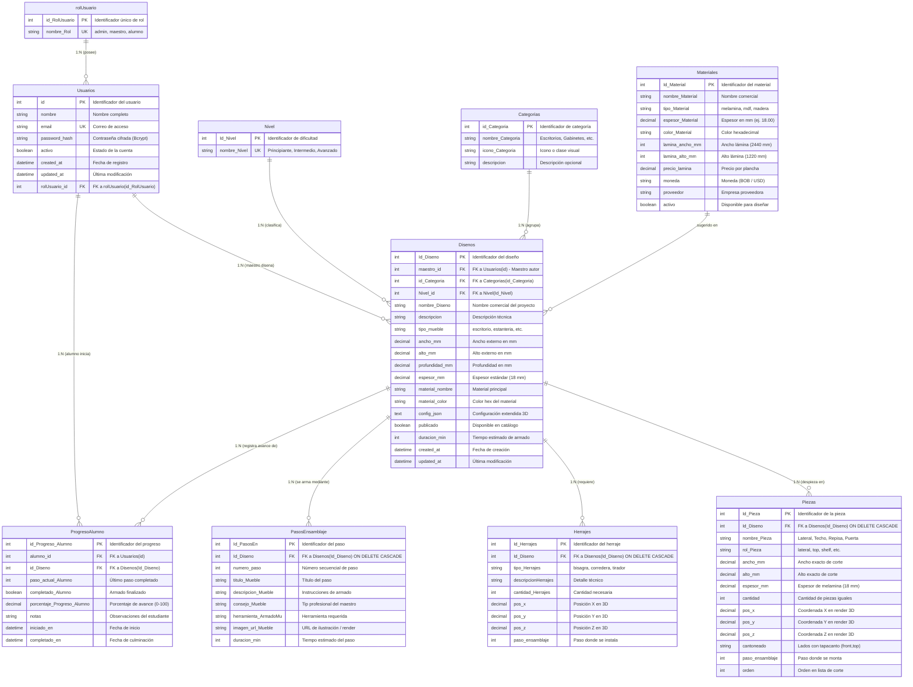

---

## 4.2. Diccionario de Datos Completo (Las 10 Tablas del Sistema)

### 1. Tabla: `rolUsuario` (Lookup)
| Columna | Tipo | Restricción | Descripción |
| :--- | :--- | :---: | :--- |
| `id_RolUsuario` | `INT IDENTITY(1,1)` | **PK** | Identificador único del rol. |
| `nombre_Rol` | `NVARCHAR(20)` | **NOT NULL, UNIQUE** | `'admin'`, `'maestro'`, `'alumno'`. |

---

### 2. Tabla: `Nivel` (Lookup)
| Columna | Tipo | Restricción | Descripción |
| :--- | :--- | :---: | :--- |
| `Id_Nivel` | `INT IDENTITY(1,1)` | **PK** | Identificador del nivel. |
| `nombre_Nivel` | `NVARCHAR(20)` | **NOT NULL, UNIQUE** | `'Principiante'`, `'Intermedio'`, `'Avanzado'`. |

---

### 3. Tabla: `Categorias` (Lookup)
| Columna | Tipo | Restricción | Descripción |
| :--- | :--- | :---: | :--- |
| `id_Categoria` | `INT IDENTITY(1,1)` | **PK** | Identificador de categoría. |
| `nombre_Categoria` | `NVARCHAR(50)` | **NOT NULL** | Denominación (Escritorios, Cocinas, Estantes). |
| `icono_Categoria` | `NVARCHAR(50)` | **NULL** | Nombre de icono visual. |
| `descripcion` | `NVARCHAR(100)`| **NULL** | Descripción funcional. |

---

### 4. Tabla: `Materiales` (Lookup Independiente)
| Columna | Tipo | Restricción | Descripción |
| :--- | :--- | :---: | :--- |
| `Id_Material` | `INT IDENTITY(1,1)` | **PK** | Identificador del material. |
| `nombre_Material` | `NVARCHAR(50)` | **NOT NULL** | Nombre comercial (Roble, Nogal, Blanco). |
| `tipo_Material` | `NVARCHAR(50)` | **NULL** | `'melamina'`, `'mdf'`, `'madera'`. |
| `espesor_Material`| `DECIMAL(10,2)`| **NULL** | Espesor en milímetros (18.00 mm). |
| `color_Material` | `NVARCHAR(10)` | **NULL** | Código de color hexadecimal. |
| `lamina_ancho_mm` | `INT` | **DEFAULT 2440**| Ancho estándar de la plancha matriz (mm). |
| `lamina_alto_mm` | `INT` | **DEFAULT 1220**| Alto estándar de la plancha matriz (mm). |
| `precio_lamina` | `DECIMAL(12,2)`| **DEFAULT 0** | Costo por tablero. |
| `moneda` | `NVARCHAR(5)` | **DEFAULT 'BOB'**| Moneda del precio (Bolivianos). |
| `proveedor` | `NVARCHAR(100)`| **NULL** | Nombre del fabricante/distribuidor. |
| `activo` | `BIT / BOOLEAN`| **DEFAULT 1** | Disponible para su uso. |

---

### 5. Tabla: `Usuarios`
| Columna | Tipo | Restricción | Descripción |
| :--- | :--- | :---: | :--- |
| `id` | `INT IDENTITY(1,1)` | **PK** | Identificador único de usuario. |
| `nombre` | `NVARCHAR(50)` | **NOT NULL** | Nombres y apellidos. |
| `email` | `NVARCHAR(150)`| **NOT NULL, UNIQUE**| Correo institucional de login. |
| `password_hash` | `NVARCHAR(200)`| **NOT NULL** | Contraseña cifrada en Bcrypt. |
| `activo` | `BIT / BOOLEAN`| **DEFAULT 1** | Estado operativo de la cuenta. |
| `created_at` | `DATETIME2` | **DEFAULT NOW()** | Fecha de alta. |
| `updated_at` | `DATETIME2` | **DEFAULT NOW()** | Fecha de modificación. |
| `rolUsuario_id` | `INT` | **FK → rolUsuario** | Rol asignado (1=Admin, 2=Maestro, 3=Alumno). |

---

### 6. Tabla: `Disenos` (Muebles)
| Columna | Tipo | Restricción | Descripción |
| :--- | :--- | :---: | :--- |
| `Id_Diseno` | `INT IDENTITY(1,1)` | **PK** | Identificador único del proyecto. |
| `maestro_id` | `INT` | **FK → Usuarios** | Maestro carpintero autor del diseño. |
| `id_Categoria` | `INT` | **FK → Categorias** | Clasificación del mueble. |
| `Nivel_id` | `INT` | **FK → Nivel** | Grado de complejidad de armado. |
| `nombre_Diseno` | `NVARCHAR(100)`| **NOT NULL** | Nombre comercial. |
| `descripcion` | `NVARCHAR(250)`| **NULL** | Ficha técnica y uso recomendado. |
| `tipo_mueble` | `NVARCHAR(50)` | **NOT NULL** | escritorio, estanteria, gabinete, cajonera. |
| `ancho_mm` | `DECIMAL(10,2)`| **NOT NULL** | Ancho total exterior en mm. |
| `alto_mm` | `DECIMAL(10,2)`| **NOT NULL** | Altura total exterior en mm. |
| `profundidad_mm`| `DECIMAL(10,2)`| **NOT NULL** | Profundidad total en mm. |
| `espesor_mm` | `DECIMAL(10,2)`| **DEFAULT 18.00** | Grosor del tablero (18 mm). |
| `material_nombre`| `NVARCHAR(50)` | **NOT NULL** | Acabado (Melamina Roble, etc.). |
| `material_color` | `NVARCHAR(10)` | **NULL** | Código hexadecimal del tono. |
| `config_json` | `NVARCHAR(MAX)`| **NULL** | Estructura paramétrica y ensamble 3D. |
| `publicado` | `BIT / BOOLEAN`| **DEFAULT 0** | Visible para estudiantes en el catálogo. |
| `duracion_min` | `INT` | **NULL** | Tiempo estimado de ensamblaje (minutos). |
| `created_at` | `DATETIME2` | **DEFAULT NOW()** | Fecha de creación. |
| `updated_at` | `DATETIME2` | **DEFAULT NOW()** | Última actualización. |

---

### 7. Tabla: `Piezas` (Lista de Corte y Despiece)
| Columna | Tipo | Restricción | Descripción |
| :--- | :--- | :---: | :--- |
| `Id_Pieza` | `INT IDENTITY(1,1)` | **PK** | Identificador único de pieza. |
| `Id_Diseno` | `INT` | **FK → Disenos CASCADE** | Proyecto al que pertenece. |
| `nombre_Pieza` | `NVARCHAR(50)` | **NOT NULL** | Lateral Izq, Techo, Base, Repisa. |
| `rol_Pieza` | `NVARCHAR(50)` | **NULL** | lateral, top, shelf, drawer-front. |
| `ancho_mm` | `DECIMAL(10,2)`| **NOT NULL** | Dimensión en el eje frontal (mm). |
| `alto_mm` | `DECIMAL(10,2)`| **NOT NULL** | Dimensión en el eje vertical (mm). |
| `espesor_mm` | `DECIMAL(10,2)`| **NOT NULL** | Grosor (18.00 mm). |
| `cantidad` | `INT` | **DEFAULT 1** | Número de piezas con igual medida. |
| `pos_x`, `pos_y`, `pos_z` | `DECIMAL(10,3)` | **NULL** | Coordenadas espaciales para Three.js. |
| `cantoneado` | `NVARCHAR(200)`| **NULL** | Lados con tapacanto (front, top, left). |
| `paso_ensamblaje` | `INT` | **NULL** | Fase en la que se fija la pieza. |
| `orden` | `INT` | **DEFAULT 0** | Orden de corte optimizado. |

---

### 8. Tabla: `Herrajes`
| Columna | Tipo | Restricción | Descripción |
| :--- | :--- | :---: | :--- |
| `Id_Herrajes` | `INT IDENTITY(1,1)` | **PK** | Identificador del accesorio. |
| `Id_Diseno` | `INT` | **FK → Disenos CASCADE** | Proyecto al que pertenece. |
| `tipo_Herrajes` | `NVARCHAR(50)` | **NOT NULL** | bisagra_cazoleta, jalador, riel_telescopico. |
| `descripcionHerrajes`| `NVARCHAR(100)`| **NOT NULL** | Especificación técnica (35mm c/freno). |
| `cantidad_Herrajes` | `INT` | **DEFAULT 1** | Unidades requeridas. |
| `pos_x`, `pos_y`, `pos_z` | `DECIMAL(10,3)` | **NULL** | Posición en milímetros en el modelo 3D. |
| `paso_ensamblaje` | `INT` | **NULL** | Momento de instalación del herraje. |

---

### 9. Tabla: `PasosEnsamblaje` (Guía Paso a Paso)
| Columna | Tipo | Restricción | Descripción |
| :--- | :--- | :---: | :--- |
| `Id_PasosEn` | `INT IDENTITY(1,1)` | **PK** | Identificador del paso. |
| `Id_Diseno` | `INT` | **FK → Disenos CASCADE** | Mueble que describe. |
| `numero_paso` | `INT` | **NOT NULL** | Orden correlativo (1, 2, 3...). |
| `titulo_Mueble` | `NVARCHAR(100)`| **NOT NULL** | Título breve de la etapa. |
| `descripcion_Mueble` | `NVARCHAR(200)`| **NULL** | Instrucción técnica detallada. |
| `consejo_Mueble` | `NVARCHAR(200)`| **NULL** | Recomendación de taller / seguridad. |
| `herramienta_ArmadoMu`| `NVARCHAR(50)` | **NULL** | Taladro, atornillador, escuadra. |
| `imagen_url_Mueble` | `NVARCHAR(500)`| **NULL** | Render ilustrativo del paso. |
| `duracion_min` | `INT` | **NULL** | Minutos estimados para completar el paso. |
| **Restricción** | `UNIQUE(Id_Diseno, numero_paso)` | — | Impide duplicidad en el número de paso. |

---

### 10. Tabla: `ProgresoAlumno`
| Columna | Tipo | Restricción | Descripción |
| :--- | :--- | :---: | :--- |
| `id_Progreso_Alumno` | `INT IDENTITY(1,1)` | **PK** | Identificador único de seguimiento. |
| `alumno_id` | `INT` | **FK → Usuarios** | Estudiante que realiza el armado. |
| `id_Diseno` | `INT` | **FK → Disenos** | Mueble que está fabricando. |
| `paso_actual_Alumno` | `INT` | **DEFAULT 1** | Último paso verificado. |
| `completado_Alumno` | `BIT / BOOLEAN`| **DEFAULT 0** | Mueble terminado al 100%. |
| `porcentaje_Progreso_Alumno`| `DECIMAL(5,2)` | **DEFAULT 0.00** | Porcentaje acumulado (0 a 100%). |
| `notas` | `NVARCHAR(500)`| **NULL** | Observaciones del estudiante. |
| `iniciado_en` | `DATETIME2` | **DEFAULT NOW()** | Fecha de inicio del proyecto. |
| `completado_en` | `DATETIME2` | **NULL** | Fecha de certificación final. |
| **Restricción** | `UNIQUE(alumno_id, id_Diseno)` | — | Un registro de seguimiento por alumno-diseño. |

---

# 5. DIAGRAMA DE CLASES DEL DOMINIO (UML)

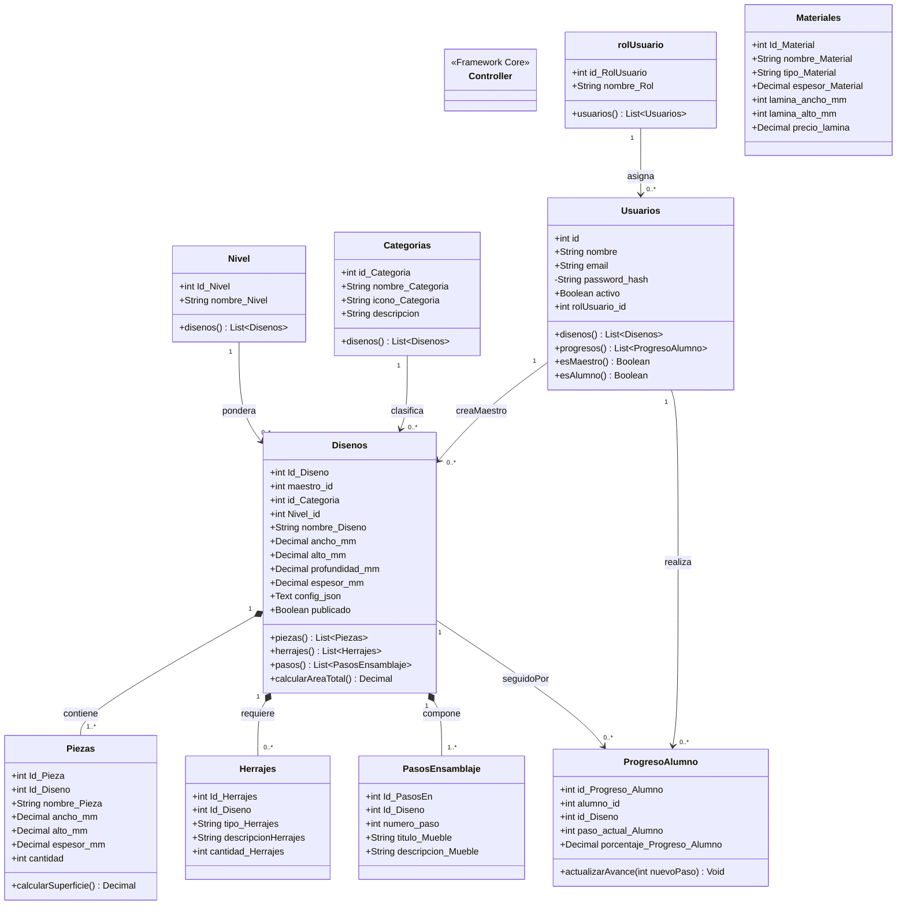

---

# 6. DIAGRAMAS DE PAQUETES (UML)

```mermaid
graph TD
    subgraph Capa_Presentacion[" Capa de Presentación (Frontend / Cliente) "]
        direction TB
        subgraph Pkg_VistasBlade["«package» Vistas_Blade"]
            V_Auth["Auth (Login, Registro)"]
            V_Admin["Admin (Dashboard, Gestión Usuarios/Muebles)"]
            V_Maestro["Maestro (Dashboard Taller, Editor 3D)"]
            V_Catalogo["Catálogo (Listado, Ficha Técnica, Guía Armado)"]
        end

        subgraph Pkg_Motor3D["«package» Motor_Diseño_3D"]
            M_Three["designer-app.js (Three.js WebGL & Escena)"]
            M_Engine["engine.js (Cálculo Paramétrico de Cotas)"]
            M_Wizard["wizard.js (Biblioteca de Plantillas Base)"]
            M_Corte["Optimizador_Corte (Algoritmo FFDH Bin-Packing)"]
        end

        subgraph Pkg_Assets["«package» Recursos_UI_Assets"]
            A_Texturas["Texturas Melamina (public/textures)"]
            A_Estilos["Estilos & UI (Bootstrap 5, Tailwind CSS)"]
        end
    end

    subgraph Capa_Aplicacion[" Capa de Aplicación y Seguridad (Backend) "]
        direction TB
        subgraph Pkg_Seguridad["«package» Seguridad_Middleware"]
            Mid_Auth["Authenticate (auth)"]
            Mid_Rol["CheckRol (rolUsuario_id)"]
            Mid_Admin["EsAdmin (admin = true)"]
        end

        subgraph Pkg_Controladores["«package» Controladores_MVC"]
            C_Mueble["MuebleController"]
            C_Catalogo["CatalogoController"]
            C_Maestro["MaestroController"]
            C_Favorito["FavoritoController"]
            C_Perfil["PerfilController"]
            C_Auth["AuthController"]
        end
    end

    subgraph Capa_Dominio[" Capa de Dominio (Modelos de Negocio) "]
        subgraph Pkg_Modelos["«package» Modelos_Dominio"]
            Mod_User["Usuarios & rolUsuario"]
            Mod_Diseno["Disenos, Nivel, Categorias"]
            Mod_Despiece["Piezas, Herrajes, PasosEnsamblaje"]
            Mod_Progreso["ProgresoAlumno & Materiales"]
        end
    end

    subgraph Capa_Servicios[" Capa de Servicios e Integración "]
        subgraph Pkg_Servicios["«package» Servicios_Externos"]
            S_WhatsApp["Integrador WhatsApp (wa.me +591)"]
            S_PDF["Generador Planos Técnicos (PDF Taller)"]
        end
    end

    subgraph Capa_Infraestructura[" Capa de Infraestructura y Datos "]
        subgraph Pkg_Persistencia["«package» Persistencia_Datos"]
            ORM_Eloquent["Eloquent / PDO Engine"]
            DB_Driver["Driver RDBMS (PostgreSQL / SQL Server)"]
            FS_Local["Filesystem Local (Snapshots 3D & Storage)"]
        end

        subgraph Pkg_BD["«package» Base_Datos_Relacional"]
            T_Tablas["10 Tablas Normalizadas (3FN)"]
        end
    end

    Pkg_VistasBlade ..> Pkg_Motor3D : «use»
    Pkg_Motor3D ..> Pkg_Assets : «use»
    Pkg_VistasBlade ..> Pkg_Controladores : «http request»
    Pkg_Controladores ..> Pkg_Seguridad : «import»
    Pkg_Controladores ..> Pkg_Modelos : «use»
    Pkg_Controladores ..> Pkg_Servicios : «use»
    Pkg_Modelos ..> Pkg_Persistencia : «extends»
    Pkg_Persistencia ..> Pkg_BD : «access»
```

---

# 7. DIAGRAMAS DE DESPLIEGUE (UML)

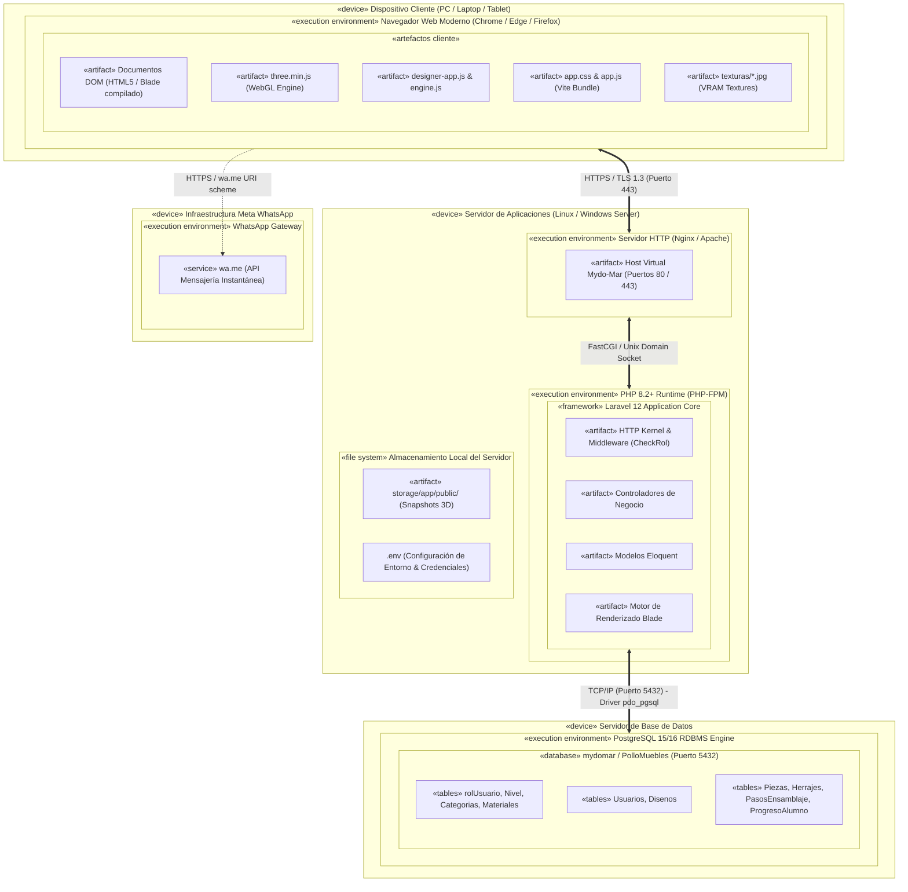
